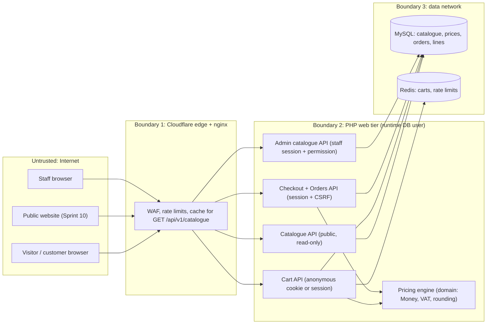

# Threat Model — Commerce: catalogue, pricing, cart, checkout and orders

| | |
|---|---|
| Epics | BE-03 Catalogue & pricing, BE-04 Cart & checkout, FE commerce screens, admin catalogue (Sprint 2) |
| Method | STRIDE per element of the data-flow diagram |
| Requirements | CAT-001…004, CAT-006, PRC-001…008, PRC-010, CRT-001, CRT-002, CRT-005, ORD-001, ORD-002, ORD-004, ACC-004, CMP-010, NFR-012 |
| Standard | OWASP ASVS 5.0 — Level 2; **Level 3** for anything that sets or changes a price, a VAT rate or an order total |
| Status | Baseline, written **before** any commerce code (Sprint 2, 20 Oct 2026). Payments, invoices as documents, the ledger and refunds have their own model in Sprint 3. |

Every Sprint 2 commerce PR cites the threat IDs (`C-xx`) it mitigates and adds the matching tests from §7. A threat counts as mitigated only when its test exists and passes in CI.

---

## 1. Scope

In scope:

- **Catalogue data.** Products, plans, billing cycles and typed options, their lifecycle states (CAT-002), and the provider mapping kept apart from customer-facing data (CAT-003).
- **Prices.** Effective-dated NGN and USD sell prices per cycle, with first-term and renewal prices; provider cost; VAT rate.
- **Public catalogue API.** Read-only and cached; used by the website and the portal (CAT-006).
- **Server-side cart.** Anonymous cart under a signed cookie, merged into the account cart at sign-in (CRT-001, CRT-002).
- **Billing details and billing currency** (ACC-004, PRC-003).
- **Checkout.** Creates an Order and its first Invoice record atomically, once per idempotency key (CRT-005).
- **Orders.** State machine (SRS §5.1), immutable line snapshots, and the customer's order list (ORD-001, ORD-002, ORD-004).
- **Staff catalogue management** in the admin console (CAT-001, PRC-005).

Out of scope here:

- **Sprint 3:** payment gateways and webhooks; invoice numbering, PDF and credit notes; the ledger; refunds.
- **Sprint 4:** provisioning.
- **Identity, sessions, CSRF and staff sign-in:** covered by THREAT-MODEL-IDENTITY.md. This model relies on them.

## 2. Assets

| Asset | Why it matters | Classification |
|---|---|---|
| Sell prices, renewal prices and VAT rate | Wrong values lose money on every sale or overcharge customers (consumer-protection exposure) | Integrity-critical (L3) |
| Provider cost and margin | Commercially sensitive; leaking it weakens negotiation and invites undercutting | Confidential |
| Provider mapping (adapter + product reference) | Leaks which upstream we use; integrity decides what gets provisioned | Confidential, integrity-critical |
| Cart contents | A customer's intended purchases; tampering changes what they pay for | Internal, integrity |
| Orders and their line snapshots | Legal record of what was sold, at what price and tax | Integrity-critical, retained (NDPA/tax) |
| Billing details (name, company, address, phone, TIN) | Personal data | Confidential (NDPA 2023) |
| Idempotency keys | Prevent double orders and double charges | Integrity |

## 3. Data-flow diagram and trust boundaries

Boundaries:

1. **Everything the browser sends is untrusted:** prices, totals, currencies, plan states and option values are recomputed or re-validated on the server.
2. **The web tier connects as the runtime database user.** Its per-table grants (THREAT-MODEL-IDENTITY §6.22) make order lines append-only.
3. **Staff catalogue changes** need a staff session and a catalogue permission, are audited, and take effect only from a future date.

## 4. Assumptions

- Identity, sessions, CSRF, the Origin/JSON write guard and staff RBAC behave as the identity threat model describes.
- Sell prices are set by staff in the admin console. The CEO sets launch prices before beta (BR-05).
- The VAT rate and treatment are confirmed by the accountant (BR-06/BR-07). Until then, 7.5% is the configurable default for Nigerian customers and 0% for others.
- PHP runs on 64-bit integers. All amounts stay far below 2^53, so the TypeScript `number` type is exact for display.

## 5. Design decisions this model fixes

| ID | Decision |
|---|---|
| CD-1 | **Money is an integer of minor units plus an ISO 4217 code** (`NGN`, `USD` only at launch). Arithmetic exists only on `Money`. Adding or comparing different currencies throws. Amounts are bounded to ±10^13 minor units (₦100 billion / $100 billion), so no operation can overflow. There is no `float` anywhere in a money path (PRC-001); a CI check enforces it. |
| CD-2 | **Percentages are integer basis points** (7.5% = 750 bp). `amount × bp / 10000` is computed in integers and rounded half-up (away from zero for negatives) at line level; totals are sums of rounded lines (PRC-008, PRC-010). |
| CD-3 | **The server is the only price authority.** Cart and checkout requests carry plan, cycle, options and quantity only. Any price, total, tax or currency field in a request is ignored. The response always shows the server-computed figures (CRT-001). |
| CD-4 | **Prices are explicit rows** keyed by (plan, cycle, currency, effective_from), with first-term and renewal amounts. A plan can become ACTIVE only when every cycle has both NGN and USD prices (PRC-002). A new price row's effective date must be in the future, so history is never rewritten (PRC-005). Orders snapshot the price row they used. |
| CD-5 | **Provider mapping and cost live in separate tables** that customer-facing queries never join. Public and customer DTOs are built from an allow-list of fields, never by serialising entities. A test asserts that no `provider`, `cost`, `margin` or `reference` key appears in any customer payload (CAT-003, PRC-004). |
| CD-6 | **Cart storage.** Carts live server-side in Redis. • A signed-in cart is keyed by account ID. • An anonymous cart is keyed by SHA-256 of a 256-bit random ID, sent in a `__Host-pc_cart` cookie (HttpOnly, Secure, SameSite=Lax). • A cart holds at most 20 lines and expires after 30 days. • At sign-in the anonymous cart's lines are merged into the account cart (still within the limits) and the anonymous cart is deleted (CRT-001, CRT-002). |
| CD-7 | **Checkout is one database transaction.** It reloads current prices and plan states, checks verification, terms and billing details, then writes the order, its lines and the invoice record. An `Idempotency-Key` header (unique per account) makes a repeat return the first result (CRT-005). |
| CD-8 | **Order lines are immutable in the database.** The runtime user gets `SELECT, INSERT` only on `order_lines`, the same treatment as `audit_events`. Order status changes only through the domain state machine (§5.1), and every transition is audited (ORD-001, ORD-002). |
| CD-9 | **Customer order reads are scoped by the session's account in the query.** There is no account parameter; another account's order ID returns 404 (ORD-004). |
| CD-10 | **Billing currency is chosen when billing details are first saved:** NGN for Nigeria, USD otherwise. It locks with the first invoice, and the cart prices in that currency only (PRC-003). |
| CD-11 | **Catalogue text** (names, descriptions, option labels) is plain text with length limits. It is rendered as text, never as HTML, in every frontend. |
| CD-12 | **Tax rates are a per-country table, not code** (CEO decision, 20 Oct 2026). Each row holds country (ISO 3166-1 alpha-2), tax name, rate in basis points and effective-from date. One fallback row covers every unlisted country, set to 0%. The home country is Nigeria at 7.5%. Each product kind can be marked taxable or not. • Only Finance or Security Admin staff can change rates. Changes are future-dated and audited. • **The tax country is the billing-address country.** The Cloudflare visitor country only pre-fills the form. • Both countries are stored on the order. A mismatch where the billing country has a lower rate than the visitor country flags the order for review; the order is still taxed by billing country. • The rate, tax name and amount are snapshotted on each order line and invoice, so later rate changes never alter past documents. • A country is added only once Paxofi is tax-registered there (accountant to confirm). This replaces the two-rate `VatPolicy` in the billing-details/checkout work. |

## 6. Threats (STRIDE)

Ratings: **L** likelihood and **I** impact on a 1–3 scale.

### 6.1 Prices and totals (PRC, CRT-001)

| ID | STRIDE | Threat | L | I | Mitigation | Req | Test |
|---|---|---|---|---|---|---|---|
| C-01 | T | Client sends a lower price, total, discount or tax in a cart or checkout request | 3 | 3 | CD-3: request schema has no price fields; unknown fields rejected; totals recomputed | CRT-001 | `CartIgnoresClientPricesTest` |
| C-02 | T | Float rounding or mixed-currency arithmetic produces wrong totals | 2 | 3 | CD-1, CD-2; `Money` rejects mixed currencies; CI forbids `float` in money code | PRC-001, PRC-010 | `MoneyTest`, `PercentageRoundingTest`, `NoFloatMoneyTest` |
| C-03 | T | Integer overflow from huge quantities or amounts wraps a total negative | 1 | 3 | CD-1 bounds; quantity and term limits (CRT-002); checked multiplication | PRC-001, CRT-002 | `MoneyBoundsTest` |
| C-04 | T | VAT computed on the wrong base, wrongly rounded or applied to the wrong customers | 2 | 3 | CD-2 per-line VAT; rate from configuration (basis points), country rule from billing details; shown separately | PRC-008 | `VatTest` (₦10,000 → ₦750 acceptance case) |
| C-05 | T | Price changes between "add to cart" and "checkout", or are back-dated to alter past orders | 2 | 2 | CD-4 effective dating with future-only start; checkout re-prices and reports the change; orders snapshot the price row | PRC-005 | `PriceEffectiveDateTest`, `CheckoutRepricesTest` |
| C-24 | T | Customer picks a zero-rate billing country to avoid VAT | 2 | 2 | CD-12: billing country and Cloudflare country both stored; lower-rate mismatch flags the order for review; rate snapshotted | PRC-008 | `TaxCountryMismatchTest` |
| C-06 | E | Customer switches billing currency to buy at a cheaper USD/NGN price | 2 | 2 | CD-10 lock after first invoice; cart currency comes from the account, not the request | PRC-003 | `BillingCurrencyLockTest` |

### 6.2 Catalogue integrity and disclosure (CAT)

| ID | STRIDE | Threat | L | I | Mitigation | Req | Test |
|---|---|---|---|---|---|---|---|
| C-07 | E | Customer buys a DRAFT, DEPRECATED or RETIRED plan through the API | 2 | 2 | Plan state checked at add-to-cart **and** again at checkout | CAT-002 | `PlanStateGateTest` |
| C-08 | T | Invalid or injected option values (unknown location, out-of-range integer) reach provisioning | 2 | 3 | Typed options with enum or range validation against the plan definition; unknown options rejected, with the option named in the error | CAT-004 | `OptionValidationTest` |
| C-09 | I | Public or customer API leaks provider name, provider reference, cost or margin | 2 | 2 | CD-5 allow-listed DTOs; separate tables | CAT-003, PRC-004 | `CustomerPayloadHasNoProviderDataTest` |
| C-10 | T | Staff without the catalogue permission changes prices or plans; or a permitted staff member sets an absurd price | 2 | 3 | AdminGate + catalogue permission; audited before/after values; activation blocked without both currencies; future-dated prices only | CAT-001, PRC-002, PRC-005 | `AdminCatalogueAuthorizationTest`, `PlanActivationNeedsBothCurrenciesTest` |
| C-11 | T | Stored XSS through product or option text | 1 | 3 | CD-11 plain text and length limits; React text rendering; strict CSP | — | `CatalogueTextValidationTest` |
| C-12 | D | Scraping or flooding the public catalogue API | 2 | 1 | Cacheable 5 minutes (`Cache-Control: public, max-age=300`); Cloudflare cache; per-IP rate limit | CAT-006 | `CatalogueCacheHeadersTest` |

### 6.3 Cart (CRT-001, CRT-002)

| ID | STRIDE | Threat | L | I | Mitigation | Req | Test |
|---|---|---|---|---|---|---|---|
| C-13 | I/T | Reading or changing another visitor's cart | 2 | 2 | CD-6: anonymous carts keyed by the hash of a 256-bit random cookie; account carts keyed by the session's account; no cart ID in URLs | CRT-001 | `CartIsolationTest` |
| C-14 | D | Cart flooding (many anonymous carts or lines) exhausts Redis | 2 | 2 | 20 lines per cart, 30-day TTL, per-IP rate limit on cart writes, bounded line size | CRT-002 | `CartLimitsTest` |
| C-15 | T | Planted anonymous cart: an attacker sets a victim's cart cookie so attacker-chosen items merge into the victim's account cart | 1 | 1 | `__Host-` cookie (cannot be set from a subdomain); merge never checks out; checkout review lists every line; lines can be removed | CRT-001 | `CartMergeTest` |
| C-16 | T | Cross-site requests modify a signed-in cart | 2 | 1 | Existing Origin/JSON write guard; session writes need the CSRF token | API | covered by `ApiWriteGuardMiddlewareTest` + cart route tests |

### 6.4 Checkout and orders (CRT-005, ORD)

| ID | STRIDE | Threat | L | I | Mitigation | Req | Test |
|---|---|---|---|---|---|---|---|
| C-17 | T/R | Double-submit or replay creates two orders (and later two charges) | 3 | 3 | CD-7 idempotency key, unique per account in the database; the same key with a different body returns 409 | CRT-005 | `CheckoutIdempotencyTest` |
| C-18 | S | Unverified account, missing terms acceptance or missing billing details places an order | 2 | 2 | Checkout preconditions in the domain service; terms version recorded on the order | CRT-005 | `CheckoutPreconditionsTest` |
| C-19 | T | Order lines or totals changed after placement (bug, SQL injection, compromised web tier) | 1 | 3 | CD-8 grants: `order_lines` SELECT/INSERT only for the runtime user; amounts and snapshots in columns with CHECKs | ORD-002 | `RuntimeGrantsIntegrationTest`, `OrderSnapshotTest` |
| C-20 | T | Order jumps to PAID or FULFILLED without payment | 1 | 3 | Domain state machine; invalid transitions throw; transitions audited; only Sprint 3 payment code may call `markPaid` | ORD-001 | `OrderStateMachineTest` |
| C-21 | I | Customer reads another account's orders (IDOR) | 2 | 3 | CD-9 query scoped by session account; 404 otherwise | ORD-004 | `OrderIsolationTest` |
| C-22 | I | Order and billing personal data leak through logs or errors | 1 | 2 | Fixed log codes, no request bodies in logs; billing data only in its tables | ACC-004 | review |
| C-23 | R | Customer disputes the price, renewal price or VAT shown at purchase | 2 | 2 | Order lines snapshot the first-term price, renewal price, VAT rate and terms version; checkout shows renewal price and date (CMP-010) | CMP-010 | `CheckoutDisclosureTest` |

## 7. Sprint 2 security test plan

| Test | Proves | Threats |
|---|---|---|
| `MoneyTest`, `PercentageRoundingTest`, `VatTest`, `MoneyBoundsTest` | Integer arithmetic, half-up rounding, the SRS acceptance figures, bounds | C-02, C-03, C-04 |
| `NoFloatMoneyTest` (CI) | No `float` in money code | C-02 |
| `PlanStateGateTest`, `OptionValidationTest`, `PlanActivationNeedsBothCurrenciesTest` | Catalogue rules | C-07, C-08, C-10 |
| `CustomerPayloadHasNoProviderDataTest`, `CatalogueCacheHeadersTest` | Disclosure and caching | C-09, C-12 |
| `CartIgnoresClientPricesTest`, `CartIsolationTest`, `CartLimitsTest`, `CartMergeTest` | Cart integrity | C-01, C-13…C-15 |
| `CheckoutIdempotencyTest`, `CheckoutPreconditionsTest`, `CheckoutRepricesTest`, `CheckoutDisclosureTest` | Checkout | C-05, C-17, C-18, C-23 |
| `OrderStateMachineTest`, `OrderSnapshotTest`, `OrderIsolationTest`, runtime grants on `order_lines` | Orders | C-19…C-21 |

## 8. Residual risks

| ID | Risk | Why accepted | Owner | Revisit |
|---|---|---|---|---|
| CR-1 | A staff member with the catalogue permission can set a wrong (e.g. zero) future price | Business rule, not a technical control; changes are audited and shown in a review screen. A second approver for large price drops is Phase 2 | CEO | Sprint 9 |
| CR-2 | VAT treatment (rate, domains from foreign registrars, non-Nigerian customers) is not yet confirmed by the accountant | Rate is configuration, not code; default 7.5% / 0% follows SRS BR-06/BR-07 | CEO / accountant | Before beta |
| CR-3 | Anonymous cart contents can be read by anyone holding the cookie (e.g. a shared computer) | A cart holds no personal or payment data | Product | — |

## 9. Open items

| ID | Item | Decision needed by |
|---|---|---|
| CO-1 | Launch price points and provider costs for each plan (BR-05) | CEO, before beta |
| CO-2 | VAT rates and treatment confirmation (BR-06, BR-07): Nigeria rate, taxable product kinds (e.g. domains from foreign registrars), and the countries where Paxofi is tax-registered. Design decided by the CEO (CD-12) | Accountant, before beta |
| CO-3 | Coupons (PRC-007, Should). **Decided 20 Oct 2026: deferred until after the core purchase flow** (catalogue → cart → checkout → payment) | Closed |

## 10. Review log

| Date | Change | By |
|---|---|---|
| 2026-10-20 | Baseline, written before any commerce code | Claude (security engineering) |
| 2026-10-20 | CD-12 per-country tax table + C-24 (CEO VAT decision); CO-3 closed (coupons deferred) | Claude (security engineering) |
