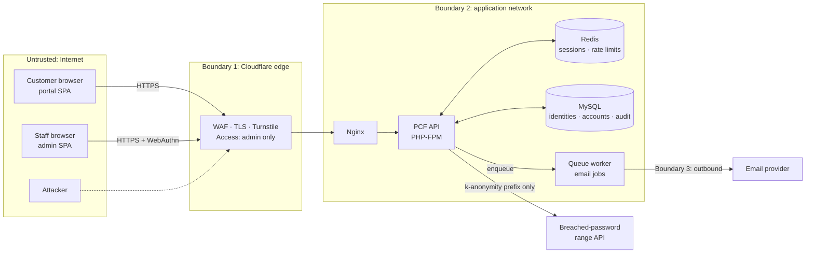

# Threat Model — Identity, Sessions, Tenant Isolation and Audit (Sprint 1)

| | |
|---|---|
| Epic | Identity & access (SEC-01 / SEC-02 / BE-06) |
| Method | STRIDE per element of the data-flow diagram |
| Requirements | IAM-001…016, IAM-017 (sign-in notifications; new, pending SRS change record), ACC-001…003, ACC-005, AUD-001…004, API-002…008, SEC-011 |
| Standard | OWASP ASVS 5.0 — Level 2; Level 3 for staff authentication and the admin console |
| Status | Baseline for Sprint 1. Must be re-reviewed at Sprint 1 planning and updated at sprint end. |

This document is written **before** any identity code exists. Every Sprint 1
pull request touching identity must cite the threat IDs (`T-xx`) it mitigates
and add the matching tests listed in §7. A threat is only "mitigated" when its
test exists and passes in CI.

---

## 1. Scope

In scope:

- Customer registration, email verification, sign-in, sign-out.
- Passwords (policy, storage, reset), TOTP MFA and recovery codes.
- Server-side sessions, CSRF, step-up authentication, email change.
- Staff authentication with WebAuthn and staff role-based access control.
- Tenant isolation (identity → account → resources).
- Security audit log and log redaction.
- Edge controls that protect these flows: rate limiting, bot protection,
  security headers, CORS.

Out of scope (own threat models later): payments and webhooks (Sprint 3),
provider credentials (Sprint 3), provisioning (Sprint 4), the admin console's
business functions (Sprint 9).

## 2. Assets

| Asset | Why it matters | Classification |
|---|---|---|
| Customer credentials (password hash, TOTP secret, recovery codes) | Account takeover → domains, servers, money | Restricted |
| Session identifiers and CSRF tokens | Bearer access to an account | Restricted |
| One-time tokens (verify, reset, email-change, staff invite) | Bearer access to a specific action | Restricted |
| Staff WebAuthn credentials and staff sessions | Access to every customer | Restricted (L3) |
| Identity PII (name, email, phone, IP history) | NDPA 2023 personal data | Confidential |
| Account ownership (identity ↔ account ↔ resources) | Basis of tenant isolation | Integrity-critical |
| Audit log | Evidence for disputes, fraud and incident response | Integrity-critical |
| Encryption keys (TOTP secret key, audit/HMAC keys) | Protect the assets above | Restricted; environment secrets only |

## 3. Data-flow diagram and trust boundaries

Trust boundaries:

1. **Internet → edge.** Everything from a browser is untrusted, including the
   frontend SPAs, which are public code.
2. **Edge → application.** Origin accepts traffic only from Cloudflare (origin
   firewall and authenticated origin pulls). The API never trusts client IP
   headers other than `CF-Connecting-IP`, and only on that path.
3. **Application → third parties.** Outbound calls go only to allow-listed
   hosts with timeouts and size caps, and never carry secrets beyond what the
   call needs.

## 4. Assumptions

- PHP 8.4+, libsodium and `password_hash` are trustworthy; we never implement
  cryptographic primitives ourselves (company rule).
- Cloudflare terminates TLS in Full (strict) mode; the origin certificate is
  valid (SEC-007).
- Redis and MySQL are reachable only from the application network, require
  authentication, and are not exposed publicly (SEC-013).
- The email channel is the customer's recovery root. Its compromise is a
  residual risk (R-1) reduced by MFA, not eliminated.
- At MVP one identity owns exactly one account (ACC-001); team membership is
  Phase 2 but the authorizer already checks membership, so the model will not
  change.

## 5. Design decisions this model fixes

These are binding for Sprint 1 implementation. Changing one requires updating
this document in the same PR.

| ID | Decision |
|---|---|
| D-1 | **Random values:** every token, session ID and recovery code comes from `random_bytes()` with ≥ 256 bits of entropy (recovery codes: ≥ 80 bits, human-readable). |
| D-2 | **Token storage:** one-time tokens and session IDs are stored only as `SHA-256(token)`; lookup is by hash; the raw value exists only in the email or cookie. A leaked database or Redis dump therefore yields no usable tokens. |
| D-3 | **Passwords:** `password_hash($p, PASSWORD_ARGON2ID, ['memory_cost' => 65536, 'time_cost' => 3, 'threads' => 1])`, `password_needs_rehash` on every successful sign-in. The algorithm is set explicitly; framework defaults are never relied on. |
| D-4 | **TOTP secrets:** 160-bit secrets, encrypted at rest with `sodium_crypto_aead_xchacha20poly1305_ietf_encrypt`, key from environment, ciphertext carries a key ID for rotation, the identity ID is bound as associated data. TOTP verification implements RFC 6238 (HMAC-SHA1, 30 s step, ±1 step) with `hash_equals`, and stores the last accepted time-step to block replay. Unit tests use the RFC 6238 test vectors. |
| D-5 | **Recovery codes:** 10 codes, stored as keyed hashes (`sodium_crypto_generichash` with a server key), single-use, regenerating them invalidates the old set. |
| D-6 | **Sessions:** server-side in Redis under key `sess:{SHA-256(sid)}`; cookie `__Host-pc_sid` (Secure, HttpOnly, SameSite=Lax, Path=/). Staff use a separate cookie `__Host-pc_staff`, a separate Redis prefix and a separate origin; a customer session is never accepted on admin routes and vice versa. Session ID rotates on sign-in, MFA completion, step-up, password change and role change. |
| D-7 | **Uniform responses:** registration, sign-in and password reset return the same response and comparable timing whether or not the email exists. Sign-in for an unknown email runs `password_verify` against a fixed dummy Argon2id hash. |
| D-8 | **Password reset does not bypass MFA.** After a reset the customer must still pass TOTP (or use a recovery code) to sign in. Reset revokes all sessions. |
| D-9 | **No SMS for authentication.** Phone numbers are for contact only, which removes SIM-swap as an attack path. |
| D-10 | **WebAuthn verification uses a vetted, minimal open-source library**, not our own CBOR/COSE/attestation parsing (company rule against rolling our own crypto; a library is not a framework). Required settings: `userVerification=required`, RP ID pinned to the admin origin, sign-count checks, ES256 and EdDSA only. **Library choice is an ADR in Sprint 0** (open item O-1). |
| D-11 | **Staff onboarding:** staff accounts are created only by invitation from a staff manager (the very first by the operator bootstrap). The invite is a single-use 24-hour link. *Amended 19 Oct 2026 (CEO decision, §6.20):* the link leads to setting a password and an authenticator app (TOTP) with recovery codes; passkeys are optional and added later from the console. No self-signup. |
| D-12 | **No impersonation at MVP.** Support staff never "log in as" a customer; they act through audited admin endpoints. |
| D-13 | **Authorization order:** authenticate → load session → resolve the account from the session (never from the request) → `AuthoritativeTenantAuthorizer::assertCanAccess` → load the resource **scoped by account ID in the query** → act. A resource owned by another account returns **404**, not 403, so existence is not revealed. |
| D-14 | **Audit log:** append-only table; the application DB user has `INSERT, SELECT` only; each row stores `hash = SHA-256(prev_hash ‖ canonical_json(event))`. The current chain head is exported daily to storage outside the database (open item O-2) so a database administrator cannot silently rewrite the chain. |

## 6. Threats (STRIDE)

Ratings: **L** likelihood and **I** impact on a 1–3 scale; risk = L × I.
"Test" names the CI test that proves the mitigation (§7).

### 6.1 Registration and email verification (IAM-001, IAM-002, IAM-016)

| ID | STRIDE | Threat | L | I | Mitigation | Req | Test |
|---|---|---|---|---|---|---|---|
| T-01 | I | Account enumeration: "email already registered" reveals customers | 3 | 2 | D-7: always "check your email"; an existing address receives a "someone tried to register" email instead | IAM-001 | `RegistrationEnumerationTest` |
| T-02 | D | Bot mass-registration exhausting email quota or polluting data | 3 | 2 | Turnstile verified server-side (fail closed), per-IP limit 5/h, email sending via queue with a global cap | IAM-016, API-004 | `RegistrationRateLimitTest` |
| T-03 | S | Verification token guessed or reused | 1 | 2 | D-1, D-2; single-use, 24 h expiry; a new token invalidates older ones | IAM-002 | `EmailVerificationTokenTest` |
| T-04 | T | Mass assignment, e.g. `{"role":"admin","account_id":…}` in the body | 2 | 3 | Strict input schema that rejects unknown fields; role and account are never accepted from the client | API-002 | `RegistrationSchemaTest` |
| T-05 | I | Unverified identity places orders or receives services | 2 | 2 | `verified_at` is checked on checkout; unverified identities have read-only scope | IAM-002 | `UnverifiedCannotOrderTest` |
| T-46 | S | **Account pre-hijacking:** an attacker registers a victim's email first, so the account later verified by the victim carries the attacker's password | 1 | 3 | A pending (unverified) identity is overwritten by the latest registration (name, phone, password) and every older verification token is deleted, so only the newest submission can ever be activated; per-email limit 3/h makes racing the victim impractical; unverified identities cannot sign in (sign-in PR); the "verified" step does not reveal the account's password or details | IAM-001, IAM-002 | `RegistrationPreHijackTest` |
| T-47 | D | Email bombing: repeated registrations for one address flood a victim's inbox | 2 | 1 | Per-email limit 3/h (keyed by the address hash) in addition to the per-IP limit; the worker's global hourly cap | IAM-016 | `RegistrationRateLimitTest` |
| T-48 | T | Cross-site POST to the registration or verification API from another origin | 2 | 2 | State-changing `/api` requests must carry an `Origin` equal to `APP_URL`'s origin and a JSON content type (which forces a CORS preflight that we never approve); sessions add the T-21 synchroniser token when they land | API-003 | `OriginGuardTest` |
| T-49 | I/D | "Resend verification email" used to learn whether an address is registered, or to flood an inbox | 2 | 2 | `POST /api/v1/auth/resend-verification` always answers the same 202 for a well-formed address. Pending: a new single-use token replaces every older one (T-46) and the link is queued. Active or other status: the owner gets the account-exists email, as at registration. Unknown address: nothing is queued. Limits run before any lookup: 10/h per IP on this endpoint, and the per-address bucket is **shared with registration** (3/h in total), so the two endpoints together cannot send more than 3 verification-type emails an hour to one address. The UI enforces a 60-second cooldown | IAM-002, IAM-016 | `ResendVerificationTest` |

### 6.2 Sign-in and passwords (IAM-003…006)

| ID | STRIDE | Threat | L | I | Mitigation | Req | Test |
|---|---|---|---|---|---|---|---|
| T-06 | S | Credential stuffing with breached passwords | 3 | 3 | Breached-password check at registration and password change (k-anonymity range API: only a 5-character SHA-1 prefix leaves our network; on API outage the check fails open, is logged and is retried at next sign-in); per-account and per-IP throttling; Turnstile after 3 failures; MFA | IAM-003, IAM-006, IAM-016 | `BreachedPasswordTest`, `SignInThrottleTest` |
| T-07 | S | Online brute force against one account, including from many IPs | 2 | 3 | Two counters in Redis: (a) per (account, client-IP bucket): 5 failures → exponential delay up to 15 min; (b) per account across all IPs: above 10 failures/hour every further attempt requires Turnstile and the owner is notified. 30/min per IP overall. MFA makes a guessed password insufficient. Events audited | IAM-006 | `SignInThrottleTest`, `DistributedBruteForceTest` |
| T-08 | D | Attacker locks a victim out by failing on purpose | 2 | 2 | No permanent lockout. Delays from counter (a) apply only to the attacker's IP bucket, so the owner's network is unaffected; counter (b) adds a Turnstile challenge, which the owner can pass, instead of blocking. Successful sign-in resets (a) for that bucket | IAM-006 | `TargetedLockoutTest` |
| T-09 | I | Timing difference reveals whether an email exists | 2 | 2 | D-7 dummy hash; identical code path and response | IAM-005 | `SignInTimingParityTest` (statistical, tolerance-based) |
| T-10 | I | Database leak exposes passwords | 1 | 3 | D-3 Argon2id with explicit parameters; rehash on sign-in | IAM-004 | `PasswordHashingTest` |
| T-11 | D | CPU/memory exhaustion: many concurrent Argon2id verifications | 2 | 2 | Rate limit before hashing; FPM worker cap sized for 64 MiB per hash; sign-in endpoint has its own worker pool limit | IAM-004, API-004 | load test in Sprint 11 |
| T-12 | T | Open redirect via `?next=` after sign-in | 2 | 2 | Only relative paths matching the portal route allowlist; anything else redirects to the dashboard | API-002 | `PostLoginRedirectTest` |

### 6.3 MFA and recovery (IAM-007, IAM-013)

| ID | STRIDE | Threat | L | I | Mitigation | Req | Test |
|---|---|---|---|---|---|---|---|
| T-13 | S | TOTP code replayed within its window | 2 | 2 | D-4 last-accepted step stored; reuse rejected | IAM-007 | `TotpReplayTest` |
| T-14 | S | TOTP brute force (10⁶ space) | 2 | 3 | 5 wrong codes → MFA step locked for 15 min and owner notified; the half-authenticated state lives max 5 min | IAM-007 | `TotpThrottleTest` |
| T-15 | I | TOTP secrets readable from a DB backup | 1 | 3 | D-4 encryption with a key outside the database | IAM-007 | `TotpSecretEncryptionTest` |
| T-16 | S | Social-engineering support to remove MFA | 2 | 3 | No recovery code → support-verified identity check **and** 24 h delay with email notice to the account, cancellable by the owner; staff action audited | IAM-013 | `MfaRecoveryDelayTest` |
| T-17 | E | Enrolling MFA without proving the current password | 2 | 2 | MFA enrol/disable/regenerate are step-up actions (T-22) | IAM-014 | `StepUpRequiredTest` |

### 6.4 Sessions and CSRF (IAM-009…011, API-003)

| ID | STRIDE | Threat | L | I | Mitigation | Req | Test |
|---|---|---|---|---|---|---|---|
| T-18 | S | Session fixation | 2 | 3 | D-6 rotation on every privilege change; a pre-auth session ID is never promoted | IAM-009 | `SessionFixationTest` |
| T-19 | I | Session theft via XSS | 2 | 3 | HttpOnly cookie; strict CSP without `unsafe-inline`; React output encoding, `dangerouslySetInnerHTML` forbidden by lint | API-005, SEC-011 | `SecurityHeadersTest`, frontend lint rule |
| T-20 | I | Session theft from a Redis snapshot | 1 | 3 | D-2/D-6 keys are hashes of the session ID; Redis on private network with ACL user and password | IAM-009, SEC-013 | `SessionStorageHashTest` |
| T-21 | T | Cross-site request forgery | 2 | 3 | Synchroniser token bound to session for every state-changing request **and** `Origin` must match an allowed origin; SameSite=Lax as defence in depth | API-003 | `CsrfTest` |
| T-22 | E | Stolen-but-idle session used for high-impact actions | 2 | 3 | Step-up within 5 min for: change email/password/MFA, domain transfer-out/EPP, VPS rebuild/delete, remove payment method | IAM-014 | `StepUpRequiredTest` |
| T-23 | R | Customer cannot tell a session was hijacked | 2 | 2 | Session list with device/IP/last seen; revoke one or all; new-device sign-in email | IAM-011 | `SessionRevocationTest` |
| T-24 | S | Sessions live forever | 2 | 2 | Idle 30 min / absolute 12 h (customer); 15 min / 8 h (staff); enforced server-side | IAM-010 | `SessionTimeoutTest` |

### 6.5 Password reset and email change (IAM-012, IAM-015)

| ID | STRIDE | Threat | L | I | Mitigation | Req | Test |
|---|---|---|---|---|---|---|---|
| T-25 | S | Reset token theft (referer leak, logs, email scanners) | 2 | 3 | D-2; 30 min, single-use; reset page sets `Referrer-Policy: no-referrer`; the token is consumed by POST, not by GET (link scanners only GET) | IAM-012 | `PasswordResetTokenTest` |
| T-26 | S | Host-header poisoning makes the reset link point to an attacker domain | 2 | 3 | Links are built from a configured base URL, never from the request `Host` | IAM-012 | `ResetLinkBaseUrlTest` |
| T-27 | E | Reset used to bypass MFA | 2 | 3 | D-8 | IAM-012 | `ResetDoesNotBypassMfaTest` |
| T-28 | S | Account takeover by changing email from a hijacked session | 2 | 3 | Step-up; confirm new address; notify old address with a 48 h revert link that also revokes sessions | IAM-015 | `EmailChangeTest` |

### 6.6 Staff authentication and RBAC (IAM-008, ACC-005)

| ID | STRIDE | Threat | L | I | Mitigation | Req | Test |
|---|---|---|---|---|---|---|---|
| T-29 | S | Phishing of staff credentials | 2 | 3 | *Changed 19 Oct 2026 (§6.20):* password + authenticator code + emailed code that names the device, location and IP signing in; admin origin behind Cloudflare Access; short staff sessions; passkeys (origin-bound, phishing-resistant) offered as the stronger option. Real-time relay phishing remains possible for code sign-in: residual risk R-5 | IAM-008 | `StaffCodeSignInTest` |
| T-30 | S | Cloned authenticator | 1 | 3 | Sign-count regression rejects and alerts; attestation policy recorded per credential | IAM-008 | `WebAuthnSignCountTest` |
| T-31 | E | Customer session reaches admin API | 2 | 3 | D-6 separate cookie, origin and Redis prefix; admin routes require a staff session | ACC-005 | `CustomerSessionRejectedOnAdminTest` |
| T-32 | E | Staff exceeds role (e.g. support issues refunds) | 2 | 3 | Deny-by-default permission map; every admin route declares its permission; CI fails if a route has none | ACC-005 | `AdminRoutePermissionCoverageTest` |
| T-33 | E | Break-glass Super Admin abused | 1 | 3 | Super Admin credentials kept offline; every use alerts the CEO and is audited; no routine work under it | ACC-005 | runbook check (Sprint 11) |
| T-34 | R | Staff denies an action | 2 | 2 | Every staff action audited with staff ID, permission used and correlation ID (D-14) | AUD-001 | `StaffActionAuditedTest` |

### 6.7 Tenant isolation (ACC-001…003)

| ID | STRIDE | Threat | L | I | Mitigation | Req | Test |
|---|---|---|---|---|---|---|---|
| T-35 | E | IDOR: customer changes an ID in the URL/body to reach another account's invoice, domain or server | 3 | 3 | D-13: account from session only; `AuthoritativeTenantAuthorizer`; repository queries always include `account_id`; 404 on mismatch | ACC-002 | **Generated per route** (`TenantIsolationRouteTest`) |
| T-36 | E | A new route ships without an isolation test | 2 | 3 | CI enumerates the route table and fails if any tenant-scoped route lacks a negative test | ACC-003 | `TenantIsolationCoverageTest` |
| T-37 | I | Response reveals that another account's resource exists (403 vs 404) | 2 | 1 | Uniform 404 | ACC-002 | `TenantIsolationRouteTest` |
| T-38 | E | Background job runs in the wrong tenant | 2 | 3 | Jobs carry account ID and re-authorize on execution; no ambient tenant state (PCF: no hidden global state) | ACC-002 | `JobTenantContextTest` (Sprint 4) |

### 6.8 Audit and logging (AUD-001…004, API-008)

| ID | STRIDE | Threat | L | I | Mitigation | Req | Test |
|---|---|---|---|---|---|---|---|
| T-39 | T | Attacker or insider edits or deletes audit rows | 1 | 3 | D-14 grants + hash chain + daily external anchor; chain verification job alerts on break | AUD-002 | `AuditChainVerificationTest`, `AuditGrantsTest` |
| T-40 | I | Secrets in logs (passwords, tokens, session IDs, TOTP secrets) | 2 | 3 | Central redaction by field name and value pattern before any log/audit write; request bodies of auth endpoints are never logged | AUD-004 | `LogRedactionTest` |
| T-41 | T | Log injection via crafted user-agent or name | 2 | 1 | Structured JSON logging only; no string concatenation | AUD-004 | `LogRedactionTest` |
| T-42 | R | Client forges request IDs to confuse investigations | 2 | 1 | Server-generated ID; client value accepted only if it matches `^[A-Za-z0-9-]{8,64}$` and is stored separately | API-008 | `RequestIdTest` |
| T-50 | S | Client forges location or device details (fake `cf-ipcity`, `User-Agent`) to mislead an investigation | 2 | 1 | The IP comes only from `CF-Connecting-IP` via nginx `real_ip` from the tunnel hop; location and device are recorded as *reported* (approximate), validated (length, characters, country `^[A-Z0-9]{2}$`) and never used for any security decision | AUD-001 | `ClientContextTest` |
| T-51 | I | The audit trail becomes a store of personal data kept forever (NDPA 2023 minimisation) | 2 | 2 | Personal request context (full IP, location, user agent) lives in a separate, purgeable table, committed to the chain only by a salted hash; deleted after 180 days by `audit:purge-context`; events themselves hold IDs and fixed reason codes only, never emails, names, passwords, codes or tokens | AUD-004 | `AuditContextPurgeTest`, `AuditEventDetailsTest` |
| T-52 | I | A customer sees another customer's activity | 1 | 3 | `GET /api/v1/account/activity` reads only events whose subject is the session's identity; no ID parameter exists | ACC-002 | `AccountActivityTest` |
| T-53 | S | A sign-in alert email is used for phishing, or carries attacker-controlled text (user agent, city) | 2 | 2 | Alerts contain no action links except the fixed `APP_URL/security` page (the customer signs in normally); device, location and IP are rendered only from validated parameters (label, location and IP patterns) and HTML-escaped; no reply-to | IAM-017 | `EmailTemplatesTest` |
| T-54 | D | Repeated sign-ins flood the owner's inbox with alerts | 2 | 1 | At most 10 sign-in alerts per identity per hour (counted in Redis); further sign-ins are still audited, the email is skipped and logged | IAM-017 | `SignInAlertsTest` |
| T-55 | S | A copied or forged device cookie makes a new device look known | 2 | 1 | The device cookie only chooses between the "new device" and the normal sign-in email: it never skips the password, MFA or any check; it is a 256-bit random value stored as SHA-256 per identity, `__Host-`, HttpOnly, Secure, SameSite=Lax | IAM-017 | `SignInAlertsTest` |
| T-56 | I | Staff without a security role read customers' full IP addresses and user agents from the audit log | 2 | 2 | §6.24: `audit.view` required, deny by default; full IP and raw user agent only with `staff.manage`; others see /24 or /64 and parsed device; purged after 180 days (T-51) | AUD-001 | `AuditLogViewerTest` |
| T-57 | R | A staff member browses the audit log (personal data) and no record shows who looked | 2 | 2 | §6.24: every page load records `audit.viewed` with subject, filters and row count (deduplicated within 60 s) | AUD-001 | `AuditLogViewerTest` |
| T-58 | E | A stolen staff session ends other staff members' sessions or hides its own trail by signing the owner out everywhere | 2 | 2 | §6.25: forced sign-out needs `staff.manage` plus a fresh authenticator code of the acting manager; own sign-outs need a fresh code too; 5 code attempts per 15 min; every action audited and emailed to the affected member; status and roles unchanged | ACC-005 | `StaffSessionControlTest` |

### 6.9 Edge and transport (API-004…006, SEC-007)

| ID | STRIDE | Threat | L | I | Mitigation | Req | Test |
|---|---|---|---|---|---|---|---|
| T-43 | I | Downgrade/strip TLS | 1 | 3 | HSTS preload, TLS 1.2+ only, Full (strict) | API-005, SEC-007 | `SecurityHeadersTest` + staging ZAP baseline |
| T-44 | T | Clickjacking of sensitive pages | 2 | 2 | `frame-ancestors 'none'` | API-005 | `SecurityHeadersTest` |
| T-45 | I | Credentialed CORS from attacker origin | 2 | 3 | Exact-origin allowlist; never reflect `Origin`; no wildcard | API-006 | `CorsTest` |
| T-46 | S | Origin bypass: attacker hits the origin IP directly, spoofing `CF-Connecting-IP` | 2 | 2 | Origin firewall allows Cloudflare ranges only; authenticated origin pulls | SEC-007, SEC-013 | staging check (Sprint 0) |
| T-47 | D | Request floods on auth endpoints | 3 | 2 | Cloudflare rate rules + application limits with 429 and `Retry-After` | API-004 | `RateLimitTest` |
| T-48 | I | Authenticated responses cached by a proxy | 1 | 2 | `Cache-Control: no-store` on authenticated responses | API-005 | `SecurityHeadersTest` |

### 6.24 Staff audit log viewer (CEO request 24 Oct 2026)

The audit log (§6.14) records every security event, but until now staff could only check it with `audit:verify` on the host. This adds a read-only page in the admin console.

- **Who (SRS §2.2).** `GET /admin-api/v1/audit-events` needs `audit.view` (Billing, Provisioning Operator, Abuse, Catalogue, Finance, Security Admin, Super Admin). Support holds only `audit.view_own`, which comes with the support tools (Sprint 9); here it is refused like any missing permission, and the refusal is audited (§6.16).
- **What is shown.** Sequence number, time, event type, outcome, the customer identity/account IDs or staff subject, the fixed-code details, and the request context (approximate location, browser/OS/device). Newest first, 50 per page, cursor by sequence number (`before`), filters: outcome, event-type group (a fixed list of prefixes such as `auth.`, `mfa.`, `staff.`, `provider.`) and one exact identity or staff ID (32 hex). Nothing typed by a staff member reaches SQL except as a bound, pattern-checked value.
- **Personal data (T-51, T-56).** The full IP address and the raw user agent are shown only to staff who also hold `staff.manage` (Security Admin, Super Admin), who investigate account takeover. Everyone else sees the IP network (/24 or /64) and the parsed device, which is enough to correlate events. Purged context (after 180 days) shows as "not kept". Nothing is decided from location (T-50).
- **Viewing is audited (T-57).** Every page load records `audit.viewed` with the staff subject, the filters and the number of rows returned, so access to personal data is itself traceable. Repeated page loads within 60 seconds with the same filters are recorded once, so the chain does not fill with refreshes.
- **Read-only.** The route has no write path and the runtime database user only holds `SELECT` (plus `INSERT` for new events) on `audit_events` (§6.22). Chain integrity remains `audit:verify`; the page shows the head sequence number and hash as the manual anchor.
- **Rendering.** Every value is rendered as text (React), never as HTML; details are fixed codes from our own code.

### 6.25 Staff session list, sign-out and forced sign-out (CEO request 24 Oct 2026)

The customer portal already lets the owner see and end their sessions (§6.21). Staff could not: a staff member could not see where else they were signed in, and a security administrator could not end a colleague's sessions (lost laptop, departure, suspected compromise) except by suspending the member.

- **Index.** Each staff session record also keeps the client IP, user agent (255 characters) and approximate location at sign-in. A per-member Redis set `pc:staff:sess:idx:{staff}` lists the record keys; it is written in the same Lua call as the record, expires with the 8-hour absolute lifetime and is pruned on read. A listed record must name the same member, so an index entry can never show someone else's session. The list shows a public ID derived from the record key (never the key or the cookie), device, location, IP, signed-in and last-active times, and which entry is the current session.
- **Own sessions.** `GET /admin-api/v1/account/sessions` (signed in). `POST .../account/sessions/revoke` (one, by public ID) and `.../revoke-others` (all but the current) need the session's CSRF token **and a fresh authenticator code**; a recovery code is not accepted here, it is kept for sign-in recovery. An unknown or someone else's public ID answers 404. The owner receives "Admin security settings changed" with the device, location, IP and time of the request.
- **Forced sign-out (T-58).** `POST /admin-api/v1/staff/sessions/end` needs `staff.manage`, CSRF and a fresh authenticator code of the *acting* manager, and names the member. It ends every session of that member and emails them ("A security administrator signed you out on every device"). A manager cannot target themselves (they use revoke-others, which keeps the current session). Ending sessions does not change the member's status or roles; suspension remains a separate action.
- **Limits and audit.** Code attempts share one counter per acting member: 5 per 15 minutes, then 429. Every success and refusal is audited (`staff.session.revoked`, `staff.sessions.revoked_others`, `staff.sessions.ended`, `staff.session_change.refused`) with the acting member as `subject` and, for a forced sign-out, the member as `target`, plus the count ended. Emails are best effort and never block the action.

## 7. Sprint 1 security test plan

Every test below must exist and pass before the Identity epic can close. They
are negative tests unless noted. Each Sprint 1 PR lists the tests it adds.

| Area | Tests |
|---|---|
| Registration | `RegistrationEnumerationTest`, `RegistrationRateLimitTest`, `RegistrationSchemaTest`, `EmailVerificationTokenTest`, `UnverifiedCannotOrderTest` |
| Sign-in | `BreachedPasswordTest`, `SignInThrottleTest`, `DistributedBruteForceTest`, `TargetedLockoutTest`, `SignInTimingParityTest`, `PasswordHashingTest`, `PostLoginRedirectTest` |
| MFA | `TotpRfc6238VectorsTest` (positive), `TotpReplayTest`, `TotpThrottleTest`, `TotpSecretEncryptionTest`, `MfaRecoveryDelayTest` |
| Sessions | `SessionFixationTest`, `SessionStorageHashTest`, `CsrfTest`, `StepUpRequiredTest`, `SessionRevocationTest`, `SessionTimeoutTest` |
| Reset / email | `PasswordResetTokenTest`, `ResetLinkBaseUrlTest`, `ResetDoesNotBypassMfaTest`, `EmailChangeTest` |
| Staff | `StaffWebAuthnOnlyTest`, `WebAuthnSignCountTest`, `CustomerSessionRejectedOnAdminTest`, `AdminRoutePermissionCoverageTest`, `StaffActionAuditedTest` |
| Tenant isolation | `TenantIsolationRouteTest` (generated), `TenantIsolationCoverageTest` |
| Audit / logs | `AuditChainVerificationTest`, `AuditGrantsTest`, `LogRedactionTest`, `RequestIdTest` |
| Edge | `SecurityHeadersTest`, `CorsTest`, `RateLimitTest` |

### 6.10 Registration implementation notes (Sprint 1, PR "registration + email verification")

- PCF's `NativePasswordHasher` uses `PASSWORD_DEFAULT` (bcrypt), which breaks D-3 and silently truncates passwords longer than 72 bytes. PaxofiCloud therefore binds its own `Argon2idPasswordHasher` with the D-3 parameters; reported to the PCF maintainers as a framework finding.
- The client IP used for rate limits is nginx's `$remote_addr`, which `real_ip_header CF-Connecting-IP` sets only for requests arriving through the tunnel (trusted loopback and Docker ranges).
- Turnstile (T-02) and the breached-password check (T-06, IAM-003) are delivered in the follow-up PR, because both add an outbound integration; staging stays behind Cloudflare Access until then.
- **T-06 at registration (implemented 2026-10-17).** Before the password is hashed, the web tier asks the Pwned Passwords range API (`api.pwnedpasswords.com`, allow-listed in `ProviderHttpClient`; same TLS, DNS-pinning and size caps as other providers) for the 5-character prefix of the password's SHA-1, with `Add-Padding: true` so response size does not leak the bucket. Only the prefix leaves our network; the suffix comparison happens locally. SHA-1 is required by that protocol and is used for nothing else (one reviewed `nosemgrep` line, covering our rule and the community weak-crypto rule). A hit returns the field error `password: breached`. Timeouts are short (2 s connect, 4 s total); on outage or a non-200 the check **fails open** and logs `password_breach_check.unavailable` (no password data). The retry at next sign-in lands with sign-in.

### 6.11 Sign-in and session implementation notes (Sprint 1, PR "sign-in API + sessions")

Written before the code; it fixes how T-06…T-12 and T-18…T-24 are met in this PR and what is deferred.

- **Endpoints.** `POST /api/v1/auth/sign-in` `{email, password}` (strict schema), `GET /api/v1/auth/session`, `POST /api/v1/auth/sign-out`. All writes keep the T-48 Origin + JSON guard.
- **Uniform failure (T-09, D-7).** Unknown email, wrong password → the same `401 invalid_credentials`. An unknown email still runs `password_verify` against a fixed dummy Argon2id hash with the D-3 parameters, so timing is comparable. Only after the correct password: `403 email_not_verified` (pending) or `403 account_unavailable` (suspended); revealing state to someone who knows the password is acceptable.
- **Throttling (T-07, T-08, T-11).** Before any hash: 30 attempts/min per client IP. Per (email, IP bucket = IPv4 /24 or IPv6 /64): from the 5th failure within 15 min the pair is locked for 30 s × 2^(n−5), capped at 15 min; a success clears the pair. The owner's own network is never locked by someone else's failures (T-08). Counter (b), failures per account across all IPs per hour, is counted and logged above 10 now; the Turnstile challenge and owner notification it triggers land with the Turnstile and audit PRs (**residual until then:** a distributed attack is limited by the per-IP and per-pair limits only).
- **Rehash (D-3).** `password_needs_rehash` after every successful sign-in; the new hash is stored.
- **Sessions (D-6, T-18, T-20, T-24).** 256-bit random session ID; Redis key `pc:sess:{SHA-256(sid)}` (raw ID never stored). Cookie `__Host-pc_sid` (Secure, HttpOnly, SameSite=Lax, Path=/, no Max-Age). Idle timeout 30 min (sliding Redis TTL and a stored `last_seen_at`), absolute 12 h (`created_at`). Every sign-in issues a new ID and destroys the session named by any cookie sent with it, so a planted ID is never promoted.
- **CSRF (T-21).** Each session has its own 256-bit synchroniser token, kept in the server-side session record (whose key is the hash of the session ID, so a Redis read yields no usable cookie) and returned in the JSON body of sign-in and `GET /session` (CORS is never granted, so other origins cannot read it). State-changing requests made with a session (sign-out now; every later authenticated write) must send it as `X-CSRF-Token`, compared with `hash_equals`, in addition to the Origin check.
- **Deferred to named follow-ups:** session list and revoke (T-23) and new-device email; breached-password retry at sign-in (T-06); audit events for sign-in success and failure (§6.8, audit PR); MFA step (T-13…T-17); staff sessions (§6.6).

### 6.12 Turnstile challenge implementation notes (Sprint 1, PR "Turnstile")

Written before the code; it fixes how T-02, T-06 and T-07 use Cloudflare Turnstile and what happens when it is unavailable.

- **Where.** Registration and "resend verification email" always require a token (T-02, T-47, T-49). Sign-in requires one only once the attempt looks risky: 3 or more failures for the (email, network) pair in 15 min (T-06), or more than 10 failures for the email across all networks in the hour (T-07 counter b). Without a valid token such a sign-in gets `403 challenge_required` **before** any password hash, and the client shows the widget.
- **No enumeration through the challenge.** Counter (b) is now counted for every email submitted, known or not, so whether a challenge is required never depends on the address having an account (T-09).
- **Server-side verification only.** The widget's token is posted with the form (`turnstile_token`) and checked with Cloudflare `siteverify` from the web tier through `ProviderHttpClient` (allow-listed `challenges.cloudflare.com`, TLS 1.2+, pinned vetted addresses, no redirects, 2 s connect / 4 s total). We accept the token only if `success` is true, `hostname` equals `APP_URL`'s host and `action` equals the form's action (`register`, `resend`, `sign_in`). The client IP and an idempotency key are sent. Tokens are single-use and expire after 300 s at Cloudflare. Tokens and the secret are never logged; only fixed reasons (`missing`, `rejected`, `transport`, `http_NNN`) are logged.
- **Fail closed (T-02).** If Cloudflare cannot be reached, a challenged request is refused with `503 challenge_unavailable` and the customer is asked to retry. Sign-ins that are not challenged are unaffected.
- **Keys.** `TURNSTILE_SITE_KEY` (public) is served by `GET /api/v1/auth/challenge`; `TURNSTILE_SECRET_KEY` goes only to the PHP web container, through the deploy agent's `web-secrets` verb into `/etc/paxoficloud/web.env` (0600), never into an image, compose file or log. Without keys, Turnstile is off; that is refused when `APP_ENV=production`.
- **Browser.** The Turnstile script is loaded only on the three forms, from `https://challenges.cloudflare.com` (CSP `script-src` and `frame-src` allow exactly that origin). Cloudflare does not support SRI for this script; accepted because Cloudflare already terminates our TLS and is in the trust boundary.
- **Residual.** An attacker who solves challenges (human farms) is still limited by the per-IP, per-pair and per-email limits; owner notification for counter (b) arrives with the audit/notification PR.

### 6.13 TOTP two-step verification implementation notes (Sprint 1, PR "MFA API")

Written before the code; it fixes how D-4, D-5 and T-13…T-17 are met in this PR and what is deferred.

- **Endpoints (all need a session, the session's CSRF token and the Origin + JSON guard).** `GET /api/v1/account/mfa` (status: TOTP on/off, recovery codes left); `POST /api/v1/account/mfa/totp/setup {password}` → a new 160-bit secret, returned once as base32 and as an `otpauth://totp/PaxofiCloud:<email>?secret=…&issuer=PaxofiCloud&algorithm=SHA1&digits=6&period=30` URI; `POST …/totp/confirm {code}` → turns TOTP on and returns 10 recovery codes once; `POST …/recovery-codes {password}` → a new set (the old set stops working); `POST …/disable {password, code | recovery_code}`.
- **Step-up (T-17).** Setup, new recovery codes and disable each require the current password in the same request (verified with Argon2id; 5 wrong passwords per identity per 15 min → 429). The general 5-minute step-up of T-22 comes with the first high-impact action that needs it.
- **Secrets at rest (D-4, T-15).** `identity_totp.secret` holds a `SecretCipher` envelope (XChaCha20-Poly1305, key ID for rotation) with associated data `totp:<identity id>`, so a ciphertext copied to another row does not decrypt. Keys: `MFA_SECRET_KEYS` / `MFA_SECRET_ACTIVE_KEY`, separate from the provider-credential KEK (which the web tier never holds, P-6). A setup that is never confirmed is replaced by the next setup; a confirmed TOTP must be disabled before a new setup.
- **Verification (D-4, T-13).** RFC 6238 over `hash_hmac('sha1')` (no own primitive), 6 digits, 30 s step, ±1 step, compared with `hash_equals`. The accepted step is stored; a code for that step or an earlier one is refused, so a code works once. RFC 6238 test vectors are unit tests.
- **Recovery codes (D-1, D-5).** 10 codes of 16 base32 characters (80 bits), shown as `XXXX-XXXX-XXXX-XXXX`; only `BLAKE2b(code, MFA_RECOVERY_KEY)` is stored; single use; input is case- and dash-insensitive.
- **Sign-in second step (T-14, T-18).** When TOTP is on, a correct password no longer creates a session: it creates an MFA ticket (256-bit, Redis `pc:mfa:{SHA-256}`, 5 min, bound to identity and account) in a `__Host-pc_mfa` HttpOnly cookie, and the API answers `200 {"status":"mfa_required"}`. `POST /api/v1/auth/sign-in/mfa {code | recovery_code}` then issues the session (new ID, as in §6.11) and deletes the ticket. 5 wrong codes delete the ticket and lock the second step for that identity for 15 min (logged; the owner email arrives with notifications). The ticket can only finish sign-in; it grants nothing else.
- **Keys on the host.** The deploy agent generates `MFA_SECRET_KEYS`, `MFA_SECRET_ACTIVE_KEY` and `MFA_RECOVERY_KEY` on first release into `identity-keys.env` (0600), mounted into the php container only; values never leave the host or reach logs. Without keys TOTP setup answers `503 mfa_unavailable` (sign-in unaffected); production refuses to start without them.
- **Deferred:** support-assisted MFA removal with 24 h delay (T-16, needs the admin console); owner email on MFA changes and lockouts (notifications); revoking other sessions on MFA changes (needs the session list, T-23); WebAuthn for customers (Phase 2).

### 6.14 Security audit log implementation notes (Sprint 1, PR "audit log")

- **What is recorded (AUD-001).** Registration (new, repeated while pending, attempt on an existing address), email verified, verification resent, sign-in succeeded / failed (with a fixed reason) / needs second step / many failures on one account, second step succeeded (TOTP or recovery code) / failed / locked, two-step verification turned on / off, recovery codes regenerated, sign-out. Each event has a type, an outcome (`success` or `failure`), the subject identity and account when known, the request ID and a small details object of fixed reason codes. Sign-in failures for unknown addresses are recorded without an identity, so credential stuffing is visible without storing the attempted address.
- **Request context (CEO request, 18 Oct 2026).** Every event also captures who and where: full client IP and its network (/24 or /64), country, region and city from Cloudflare's visitor-location headers, and browser, OS and device type parsed from the user agent (plus the raw user agent, truncated to 512 bytes). Location is approximate (VPNs, mobile carriers) and marked as reported by Cloudflare; nothing is decided from it (T-50). City and region need the Cloudflare managed transform "Add visitor location headers" on the zone; without it only the country is present.
- **Hash chain (D-14, T-39).** `audit_events` is written in one transaction that locks the single-row `audit_chain_head`, so sequence numbers are gap-free and each row stores `hash = SHA-256(prev_hash ‖ canonical JSON of the row)`. Details are stored as the exact canonical JSON string, not a MySQL JSON column, so verification recomputes byte-identical input. `bin/paxoficloud audit:verify` walks the chain, checks sequence, links, hashes, context commitments and the head, and exits 2 with the first broken sequence number. It prints the head hash, which serves as a manual anchor until O-2 is decided.
- **Context outside the chain (T-51).** The context row holds a random 128-bit salt; the event stores `SHA-256(salt ‖ canonical context)`. While the row exists it is verified; after purging (180 days, `audit:purge-context`) the chain still verifies and the commitment reveals nothing.
- **Failure policy.** Recording is best effort after the action has happened: a failed audit write never blocks sign-in or a settings change; it is logged as `audit.write_failed` at error level for alerting. Writes happen outside the action's transaction so a rolled-back action is never recorded as done.
- **Customer view (T-52).** `GET /api/v1/account/activity` (session required) returns the 20 most recent events about the signed-in identity with time, event, outcome, location, browser, OS, device and IP, so the owner can spot sign-in attempts from elsewhere.
- **Deferred / residual.** Database-level append-only enforcement needs a separate runtime MySQL user without `UPDATE`/`DELETE` on `audit_events` (D-14 grants): MySQL with binary logging refuses triggers for a non-SUPER user, so this lands with the deploy-agent change that creates that user (until then tampering is *detected* by `audit:verify`, not prevented). Daily external anchor (O-2). Scheduled purge and verification (needs the job runner, Sprint 4). Owner emails (notifications PR, CEO decision 18 Oct 2026): an email on every successful sign-in, and a distinct "new device" email instead of it when the device is not yet known (known devices are recognised by a long-lived random device cookie whose hash is stored per identity); both carry browser, OS, device type, approximate location, IP and time. Also many failed sign-ins with the same details, and MFA changes. Staff events (T-34) arrive with the admin console.

### 6.15 Sign-in notification implementation notes (Sprint 1, PR "sign-in notifications")

- **Every sign-in emails the owner (CEO decision 18 Oct 2026).** When a session is issued (password only, or after the second step) the owner gets "You signed in to PaxofiCloud" with the device (browser, OS, type), approximate location (city, region, country), IP address and time in WAT. If the device is not yet known for this identity, the same details arrive instead as "New device signed in to your PaxofiCloud account", worded as a warning, and an `auth.sign_in.new_device` audit event is recorded. One sign-in never sends both.
- **Known devices (T-55).** Every sign-in response sets `__Host-pc_dev` (256-bit random, HttpOnly, Secure, SameSite=Lax, 400 days) unless the browser already has one; `identity_devices` stores SHA-256(device token) per identity with the device label and first/last seen. Clearing cookies or a new browser profile counts as a new device, which errs on the side of warning. The cookie grants nothing.
- **Other security emails.** More than 10 failed sign-ins in an hour on one account (T-07 counter (b)) sends "Unsuccessful sign-in attempts" with the latest attempt's device, location, IP and time, once per window. Turning two-step verification on or off and regenerating recovery codes each send "Security settings changed" with the same details.
- **Limits and failure (T-54).** At most 10 sign-in alerts per identity per hour. Alerts are queued in the sealed outbox after the action, best effort: a failure to queue is logged (`notify.enqueue_failed`) and never blocks sign-in. The alert is not a substitute for the audit log, which records every event regardless.
- **Content (T-53).** Only the first name, the device label, the location, the IP and the time are inserted, each validated against a strict pattern and HTML-escaped; the only link is `APP_URL/security`. Staging only delivers to the allow-list (E-10).

### 6.16 Staff RBAC implementation notes (Sprint 1, PRs "staff RBAC core" and "staff sign-in")

Scope (CEO decision 18 Oct 2026, following the SRS): staff roles and permissions for the admin API (ACC-005) and WebAuthn-only staff sign-in (IAM-008). Customer team members (ACC-008) remain Phase 2. The admin console screens arrive in Sprint 9; this sprint builds the API foundation they will use.

- **Permission catalogue (T-32).** Every capability in SRS §2.2 is one named permission (for example `billing.refund.issue`, `billing.refund.approve`, `service.suspend.abuse`). Roles are fixed sets of permissions written in code, reviewed like code, and checked by a test that is a literal transcription of the SRS §2.2 table, so code and specification cannot drift silently. There is no wildcard and no "admin" permission; Super Admin is simply the role that holds every permission.
- **Deny by default.** `StaffAuthorizer` answers only "does this staff member hold this permission now"; anything not granted is refused, the refusal is audited (`staff.permission_denied`, with the permission) and the API returns 403. Roles are loaded from the database on every request, never cached in the session, so revoking a role takes effect at the next request.
- **Role grants and two-person rule (SEC-017, T-33).** Staff and their role assignments live in `staff_members` and `staff_role_assignments`. Granting a role needs `staff.manage`. A Super Admin grant counts only after a *different* Security Admin or Super Admin approves it (enforced by a database CHECK and by the application). Every grant, approval and revocation is audited.
- **Suspensions carry their reason.** The SRS gives Billing, Provisioning and Abuse each their own right to suspend; they are three permissions (`service.suspend.billing`, `.operations`, `.abuse`), so a Billing Officer cannot suspend for abuse and the audit trail shows on whose authority a service was suspended.
- **Four-eyes refunds (BR-17).** `billing.refund.approve` is separate from `billing.refund.issue`; the billing module (Sprint 3) will additionally refuse an approval by the person who issued the refund.
- **Separation from customers (T-31, D-6).** Staff identities are a separate table from customer identities; a staff session (next PR) uses `__Host-pc_staff`, its own Redis prefix and the admin origin, and is never accepted on customer routes or vice versa.
- **Staff sign-in (next PR, T-29, T-30, D-10, D-11).** Invitation-only enrolment (single-use 24 h link straight to WebAuthn registration, at least two authenticators), WebAuthn assertions verified by the ADR-002 library with user verification required, ES256/EdDSA only, sign-count regression rejected and alerted, no password and no fallback. The first Security Admin is created on the host with an operator CLI command; every later staff member is invited from the admin API.

### 6.17 Staff passkey implementation notes (Sprint 1, PR "staff passkeys")

WebAuthn (passkeys and security keys) is the only way staff sign in (IAM-008, D-10, D-11). Verification is done by `web-auth/webauthn-lib` (ADR-002), wrapped in `src/Integration/WebAuthn`; the application only sees our own `PasskeyCeremonies` contract.

- **Invitation (D-11).** A staff member exists first as `invited`. The invitation token is 256 bits from the CSPRNG, stored only as SHA-256, valid 24 hours, delivered by email as a link to the admin origin with the token in the URL fragment (never sent to servers in logs or `Referer`). It is never printed: not by the API, not by the operator CLI (public Actions logs). Inviting needs `staff.manage`; the very first Security Admin is invited by the operator bootstrap, which refuses once any active staff manager exists.
- **Enrolment.** The invitation token authorises registering passkeys for that one staff member only. The member becomes `active` when the **second** passkey is registered (D-11: at least two authenticators, so losing one key is not a lock-out); the invitation is consumed in the same transaction. At most 5 passkeys per member.
- **Registration policy.** `userVerification = required`, `residentKey = required` (discoverable, so sign-in needs no email field and cannot enumerate staff), attestation conveyance `none`, algorithms **ES256 (-7) and EdDSA (-8) only** (the options offer only these and the verifier's algorithm manager holds only these). The relying-party ID is the admin host and the only allowed origin is the admin origin (`ADMIN_URL`), so a credential phished on another origin cannot be used (T-29). Each member has a random 32-byte WebAuthn user handle, never the staff ID or email.
- **Ceremony challenges.** 32 random bytes, stored in Redis keyed by SHA-256 of a random ceremony ID, single use (read and deleted atomically), 5-minute expiry, bound to the ceremony type (registration or sign-in) and, for registration, to the staff member.
- **Sign-in.** Usernameless: empty `allowCredentials`. The credential ID from the response is looked up (unique index); unknown, disabled, or belonging to a non-active member ⇒ one uniform failure. The library checks challenge, origin, RP ID hash, user presence, user verification, signature and counter; the user handle must match the credential's owner.
- **Cloned authenticators (T-30).** A sign counter that does not increase (when either value is non-zero) rejects the sign-in, **disables that credential** and is audited as `staff.passkey.clone_suspected` (alerting); passkeys that always report 0 skip the check, as the spec allows.
- **Throttling.** Ceremony starts and finishes count against per-IP limits (Redis) before any verification work.
- **Audit (T-34).** Invitations, passkey registrations, activation, sign-in success and failure (fixed reason codes) and clone suspicion are audited with the staff ID in details and `identity_id` NULL.

### 6.18 Staff sessions and admin API implementation notes (Sprint 1, PR "staff sessions + admin API")

- **Separate session (D-6, T-31).** Staff sessions use the cookie `__Host-pc_staff` (Secure, HttpOnly, **SameSite=Strict**, host-only, no Max-Age), their own Redis prefix `pc:staff:sess:{SHA-256}` and shorter limits than customers (ASVS L3 for admin): **15 minutes idle, 8 hours absolute**. A new session ID is issued at every sign-in. Every request re-reads the member's status: a disabled member's sessions stop working at once. The customer cookie is never read on admin routes and the staff cookie never on customer routes.
- **Admin origin only.** The admin API lives under `/admin-api/v1/` and answers only when `ADMIN_URL` is set **and** the request's `Host` is the admin host (otherwise 404, so the customer host does not even reveal the routes). Writes need `Origin` equal to the admin origin and a JSON body (same reasoning as T-48), plus the session's CSRF token in `X-CSRF-Token`. Responses are `no-store`.
- **One table, one gate (T-32).** Every admin route is declared once in `AdminRoutes` with exactly one access rule: public (passkey sign-in and enrolment ceremonies only), any signed-in staff member (own session, sign-out), or one named `Permission`. The router is built from that table and the gate enforces the rule before the controller runs, so a route cannot be added without a rule. `AdminRouteCoverageTest` walks the table: every non-public route refuses a request without a session (401) and every permission route refuses a staff member without that permission (403, audited).
- **Uniform passkey failures.** Sign-in and enrolment failures answer one generic 401/400 problem with no reason; reasons go only to the audit log. Throttling answers 429 with `Retry-After`.
- **Activation alert.** When a new staff member completes enrolment, every other active staff manager (Security Admin, Super Admin) gets an email, so an enrolment from a stolen invitation is noticed (residual risk of §6.17).

### 6.19 Staging staff console and first-admin bootstrap (Sprint 1, PR "staging admin console")

- **Separate host.** The staff console is served on its own hostname (staging: `cloud-staging-admin.<zone>`, one label deep so the free edge certificate covers it) through the same outbound-only Cloudflare Tunnel; `ADMIN_URL` is that origin, so it is the WebAuthn relying party (§6.17) and the only host that answers `/admin-api` (§6.18). Passkeys registered there cannot be used on the customer host, and the customer session cookie (host-only `__Host-`) is never sent to it.
- **Two gates.** Cloudflare Access sits in front of the admin host with the same viewer allow-list as staging (email one-time PIN) plus the deploy service token for health checks; behind it, staff still need their passkey. Access is defence in depth, not the authentication: the app never trusts Access headers.
- **Nginx split.** A separate server block for `admin.<domain>` / `<name>-admin.<domain>` routes only `/health` and `/admin-api` to PHP and serves `admin.html`; it refuses the customer API and page. The customer server refuses `/admin-api` and `admin.html`. The admin page has a stricter CSP (no third-party script or frame), `Referrer-Policy: no-referrer`, `Permissions-Policy` allowing WebAuthn for its own origin only, `no-store` and `noindex`. Smoke tests check every one of these on the built images.
- **Browser code.** The admin page converts the server's WebAuthn JSON options to `navigator.credentials` calls and back; it holds no secrets. The invitation token is read from the URL fragment once and removed from the address bar and history before any request. The CSRF token is kept in memory only.
- **First Security Admin (bootstrap).** The deploy workflow action `staff-bootstrap` (behind the staging environment's required reviewer) sends `EMAIL=`/`NAME=` on stdin over the Access-gated SSH tunnel to the forced-command deploy agent, which validates both (fixed formats, no shell metacharacters), passes them to `staff:bootstrap` as argv (no shell) and logs neither value: Actions logs are public. The address comes from a GitHub environment secret, so it is masked even if echoed. The invitation link goes only to that mailbox, by email (it must also be in the staging mail allow-list). The app refuses the bootstrap once any active staff manager exists, so the action cannot mint a second "first" admin later; further staff are invited from the console by a staff manager (and every activation alerts the other managers, §6.18).

### 6.20 Staff sign-in with password and two codes; passkeys optional (Sprint 1, CEO decision 19 Oct 2026)

**Decision.** The CEO found passkey setup too much friction for staff. Staff now sign in with **password → authenticator-app (TOTP) code → one-time code sent to their email**. Passkeys stay as an optional, stronger way in that a member adds from the console. This replaces "WebAuthn only" in D-10/D-11 and T-29; ADR-002 is amended (library kept for the optional passkeys).

**Trade-off accepted (R-5).** A password plus two codes can be relayed in real time by a phishing proxy (the victim types all three into a look-alike page that forwards them within the codes' lifetime). Passkeys cannot be relayed because they are bound to the origin. Mitigations below make the attack harder and noticeable, not impossible.

- **Enrolment by invitation.** The invitation link (unchanged: 256-bit token, SHA-256 at rest, 24 h, URL fragment) opens a page where the member sets a **password of 15–128 characters** (no control characters; refused if found in the breached-password corpus, same check as customers, fail-open with a log) and scans a new **TOTP secret** (RFC 6238, 160-bit, encrypted at rest with the MFA key and bound to the staff ID as associated data, a different domain from customers). The member must enter a valid code to finish. In one transaction: password hash (Argon2id), TOTP confirmed, **10 recovery codes** (keyed BLAKE2b, shown once), invitation consumed, member active. Other staff managers are alerted (§6.18).
- **Existing passkey-only members** (enrolled before this change) can set up password and codes from the console after a passkey sign-in, only while they have no password yet.
- **Step 1, password.** Per-IP limit (30/min) and per-address limit (10 attempts / 15 min, counted before hashing). The address limit lets someone who knows a staff address delay that member's sign-in for 15 minutes; they must first pass Cloudflare Access, so this is accepted. Unknown address, wrong password, a member who is not active or who has no password all give the **same 401**, with one Argon2id verification each (dummy hash, D-7). Success gives no session, only a **sign-in ticket**: 256 bits, stored in Redis under its SHA-256 with the stage, the staff ID and an attempt counter, sent as `__Host-pc_staff_step` (Secure, HttpOnly, SameSite=Strict), and **10 minutes** for the whole sign-in.
- **Ticket handling.** Every step takes the ticket out of Redis atomically and, if the sign-in continues, writes it back under a **new** ID (new cookie), keeping the original expiry. Two requests racing with one ticket cannot both run; a stolen old ticket is dead. **5 wrong codes per ticket** (TOTP and email steps together) end the ticket; **20 code attempts per member in 15 minutes** (right or wrong, across all tickets) lock the code steps for that member, audited.
- **Step 2, authenticator code.** A TOTP code (each time step once, atomically, as for customers, T-13) or one recovery code (spent once). Only after this step is any email sent, so a password-only attacker cannot use the sign-in to send mail.
- **Step 3, email code.** 6 random digits (CSPRNG), stored in the ticket only as a salted SHA-256, valid until the ticket expires. A code is useless without the ticket cookie, and Redis holds tickets only under their SHA-256, so reading Redis does not let anyone finish a sign-in. The email states the **device, approximate location, IP and time** of the sign-in and says what to do if it was not them; the code is sealed in the outbox like every email (E-3) and purged after sending. A new code may be requested at most 2 times, 60 seconds apart; it replaces the old one. On success a staff session is issued (§6.18 limits unchanged) and the sign-in is audited with `method: password_codes`.
- **Optional passkeys.** Passkey sign-in (§6.17) remains a complete sign-in on its own (user verification is required, so it is already two factors and phishing-resistant). Adding a passkey needs a signed-in session **and** a current authenticator code (step-up), so a stolen session alone cannot plant a permanent way in. Passkey enrolment by invitation is removed.
- **Audit.** Each step's success and failure (fixed reason codes), lock-outs, recovery-code use, email-code sends and passkey additions; staff ID in details, never the codes or address.
- **Not in this change.** Self-service password change and authenticator reset, and an admin reset of another member's sign-in (Sprint 9 console). Until then a member who loses both phone and recovery codes needs an operator reset.

### 6.21 Customer session list and sign-out of other devices (Sprint 1, T-23)

- **What the customer sees.** The Security page lists every live session of their own identity: approximate device (browser, OS, type), approximate location and IP recorded when the session started, sign-in time and last activity, with "This device" on the current one. There is no identity or account parameter: the list is read for the session's own identity only (D-13).
- **Index.** Each session record stays under `pc:sess:{SHA-256 of the session ID}` (D-2). A per-identity Redis set `pc:sess:idx:{identity}` holds those hashes, written in the same Lua call as the record and expiring with the absolute session lifetime. Entries whose record has expired are removed when the list is read, so the set cannot grow without bound. The record now also keeps the approximate location string from Cloudflare (no extra personal data beyond what the audit context already holds).
- **Public session IDs.** The list never shows the record key: each session is identified by the first 32 hex characters of SHA-256(`session-list|` + key). Knowing it does not let anyone use or look up the session; it only names a row the owner can already see.
- **Revoke.** `POST /api/v1/account/sessions/revoke` with that ID ends the matching session of the same identity only (unknown or someone else's ID: 404, so IDs cannot be probed). `POST /api/v1/account/sessions/revoke-others` ends every session of the identity except the current one. Both are session + CSRF writes (T-21), audited (`auth.session.revoked`, `auth.sessions.revoked_others` with the count, fixed codes only). Ending the current session stays the normal sign-out.
- **Step-up (T-22), added 19 Oct 2026.** Both revokes also need the account password in the same request and, when two-step verification is on, a current authenticator code or an unused recovery code. A stolen session cookie alone therefore cannot sign the owner out. Wrong passwords count against the same per-identity limit as the two-step settings (5 per 15 minutes) and are audited as refused security changes; the request is checked before anything is revoked.
- **Owner email.** After a successful revoke the owner receives the existing "Security settings changed" email ("Another device was signed out of your account" / "All other devices were signed out of your account"), with device, location, IP and time, so a revoke the owner did not make is noticed.
- **MFA changes.** Turning two-step verification on or off and generating new recovery codes end every other session of the identity (deferred item of §6.13), so a stolen session cannot outlive the owner securing the account.
- **Not covered here.** An attacker who has the session **and** the password (and the code, if two-step is on) can still revoke the owner's sessions; that attacker already controls the account, and the owner email plus password reset (IAM-012, which will end every other session) is the recovery path. A stolen session alone can still read the list.

### 6.22 Separate runtime database user; append-only audit log at the database (D-14, T-39), 19 Oct 2026

Written before the code. Closes the §6.14 residual: until now the application connected as the schema owner, so a compromised web or worker process could `UPDATE` or `DELETE` audit rows. The hash chain *detected* that (`audit:verify`) but did not *prevent* it.

- **Two MySQL users.**
  - The **owner** (`paxoficloud`, created by the MySQL image) owns the schema. It is used only by the deploy agent, for `migrate` and `db:grants`, in short-lived containers. Its password lives in `owner.env`, which no long-running container mounts.
  - The **runtime** user (`paxoficloud_app`) is what the web tier and the mail worker use (`app.env`). Neither user can create users or touch other schemas.
  - The root password is random and never stored (`MYSQL_RANDOM_ROOT_PASSWORD`).
  - A one-time init script, run by the MySQL image as root on the first start of an empty volume, creates the runtime user and gives the owner `GRANT OPTION` on the application schema only.
- **Grants per table, from one policy in code.** `RuntimeGrants` maps every application table to the privileges the runtime user gets.
  - After every migration, `db:grants` (run as the owner) revokes everything the runtime user holds on the schema, then grants table by table from the policy.
  - There is never a schema-wide grant, and never DDL, `FILE`, `PROCESS`, `GRANT OPTION`, `CREATE USER` or routines.
  - Deny by default: a table that exists but is not in the policy stops the release ("unknown table"). Every new table is therefore a reviewed decision, and a unit test checks that the policy names exactly the tables the migrations create.
- **The policy:**
  - `audit_events`: `SELECT, INSERT`. Append-only: the runtime user cannot change or delete an event.
  - `audit_chain_head`: `SELECT, UPDATE`. It moves the single head row forward; it cannot insert or delete it.
  - `audit_event_context`: `SELECT, INSERT, DELETE`. Deleting is the 180-day privacy purge (T-51). The event keeps the salted commitment, so the chain still verifies; an early deletion looks like a purge. This is accepted, because the event row itself, its outcome and its subject cannot be changed.
  - `schema_migrations`: no access.
  - Every other table: `SELECT, INSERT, UPDATE, DELETE`.
- **Identifiers.** `GRANT` and `REVOKE` cannot bind identifiers as parameters. Table and user names come from `information_schema` or validated configuration, must match `^[a-z0-9_]{1,64}$`, and are quoted with backticks. Privileges come only from the policy constants. Nothing from a request reaches these statements.
- **Tests.** An integration test connects as a runtime user created for the test and shows the following:
  - `INSERT` and `SELECT` on `audit_events` work;
  - `UPDATE` and `DELETE` on `audit_events` are refused with MySQL error 1142;
  - `schema_migrations` cannot be read;
  - `CREATE TABLE` is refused;
  - a table missing from the policy makes `db:grants` fail.
- **Rollout.** The agent and compose file reach the host through cloud-init, so this needs an infra apply (new server, empty volume). The agent refuses to release on a host whose secrets predate the split rather than silently running as the owner.
- **Still not covered.** Whoever holds the owner password or root on the host can still rewrite the table. That is limited by the daily external anchor (O-2, R-3).

### 6.23 Founder bootstrap of operational roles (CEO decision 24 Oct 2026)

Problem: the only staff member is the founding Security Admin. Nobody may grant a role to themselves (§6.16), so the founder cannot obtain the Catalogue role needed to see provider costs and run "Sync now" (CD-19) until a second staff manager exists.

Decision (CEO, 24 Oct 2026): a **founder bootstrap**, through the existing `staff-bootstrap` deploy action and `staff:bootstrap` CLI.

- When `staff:bootstrap <email> <name>` runs and staff managers already exist, it no longer simply refuses. If **all** of the following hold, it grants the founder roles instead. Today that is **Catalogue** only.
  - Exactly **one** staff member is active.
  - That member holds the active Security Admin role.
  - That member's email matches the email given to the command.
- Checks and grants run in one transaction that locks the role grants, so two concurrent runs cannot both pass.
- Otherwise it refuses with a fixed reason (`not_sole_founder`, `founder_mismatch`) and changes nothing.
- The path closes by itself as soon as a second staff member is active. From then on, roles come only from another staff manager (§6.16 two-person rule).
- Super Admin is never a founder role.
- Each grant is audited (`staff.role.granted`, `via = founder_bootstrap`) and the founder is emailed that the role was added.
- **Residual (R-6):** someone with deploy-workflow access and the staging environment approval could run it, but only for the sole existing Security Admin's own email, and only to add Catalogue. Both controls are already required to deploy.

## 8. Residual risks

| ID | Risk | Why accepted | Owner | Revisit |
|---|---|---|---|---|
| R-1 | Compromise of a customer's email account enables password reset | MFA still required (D-8); customers without MFA remain exposed. Encourage MFA enrolment in the portal; consider requiring it for accounts holding VPS or high-value domains | CEO / product | Sprint 8 |
| R-2 | Breached-password check fails open during third-party outages | Blocking registration on a third-party outage harms availability; the check re-runs at the next sign-in | Engineering | Sprint 11 |
| R-3 | A malicious insider with database and backup access could rewrite the audit chain between anchors | Daily anchoring limits the window to 24 h; tighter anchoring when an external log store is chosen | Engineering | Sprint 9 |
| R-4 | XSS in the SPA can act as the user within the session even without stealing the cookie | Strict CSP and output encoding; independent penetration test before launch | Engineering | Sprint 11 |
| R-5 | Staff code sign-in (password + TOTP + email code) can be relayed by a real-time phishing proxy; passkeys could not | CEO decision 19 Oct 2026: passkey setup friction. Cloudflare Access gate in front of the admin host, the email code names the device/location/IP signing in, short staff sessions, passkeys offered as the stronger option. Revisit before production staff onboarding | CEO | Sprint 11 |
| R-6 | Founder bootstrap (§6.23) lets the sole Security Admin hold Catalogue as well, without a second person | CEO decision 24 Oct 2026: one-person company today. Limited to the sole active member's own email and to Catalogue, audited and emailed, closes automatically when a second staff member is active | CEO | When the first engineer joins |

## 9. Open items

| ID | Item | Decision needed by |
|---|---|---|
| O-1 | **Resolved 2026-10-18 (CEO):** `web-auth/webauthn-lib` 5.x behind our own contract; see `docs/architecture/ADR-002-WEBAUTHN-LIBRARY.md` | Sprint 0 end (23 Oct 2026) |
| O-2 | ADR: where the daily audit-chain anchor is stored (object storage with object lock, or a separate append-only service) | Sprint 1 end |
| O-3 | Choice of breached-password source (hosted range API vs. downloaded offline corpus) — privacy and availability trade-off | Sprint 1 planning |
| O-4 | **Resolved 2026-10-14:** Postmark primary, Resend secondary; see THREAT-MODEL-TRANSACTIONAL-EMAIL.md | Sprint 1 planning |

## 10. Review log

| Date | Change | By |
|---|---|---|
| 2026-10-05 | Baseline created before Sprint 1 implementation | Claude (security engineering) |
| 2026-10-17 | T-46 pre-hijacking, T-47 email bombing, T-48 cross-origin API POSTs, §6.10 registration notes; written before the registration code | Claude (security engineering) |
| 2026-10-17 | T-49 resend verification email (enumeration and email bombing); written before the resend code | Claude (security engineering) |
| 2026-10-17 | T-06 breached-password check at registration (k-anonymity range API, padding, fail-open + log), written before the code | Claude (security engineering) |
| 2026-10-17 | §6.11 sign-in and session implementation notes (T-06…T-12, T-18…T-24), written before the sign-in code | Claude (security engineering) |
| 2026-10-18 | §6.12 Turnstile implementation notes (T-02, T-06, T-07, T-47, T-49; fail closed; challenge counter made address-independent), written before the Turnstile code | Claude (security engineering) |
| 2026-10-18 | §6.13 TOTP two-step verification notes (D-4, D-5, T-13…T-17), written before the MFA code | Claude (security engineering) |
| 2026-10-18 | §6.14 audit log notes, T-50 forged context, T-51 personal data in the audit trail, T-52 activity isolation; written before the audit code | Claude (security engineering) |
| 2026-10-18 | §6.18 staff sessions + admin API notes (separate Strict cookie and Redis prefix, 15 min/8 h, admin host only, single route table with one access rule per route, activation alert); written before the code | Claude (security engineering) |
| 2026-10-18 | §6.17 staff passkey notes (invitation tokens, two-passkey activation, ES256/EdDSA only, discoverable usernameless sign-in, single-use challenges, clone detection disables the credential); written before the staff passkey code | Claude (security engineering) |
| 2026-10-18 | §6.16 staff RBAC notes (ACC-005 permission catalogue from SRS §2.2, deny by default, two-person Super Admin grants, reason-scoped suspensions); O-1 resolved by ADR-002; written before the staff RBAC code | Claude (security engineering) |
| 2026-10-19 | §6.22 separate runtime DB user and per-table grants (audit log append-only at the database); written before the code | Claude (security engineering) |
| 2026-10-19 | §6.21 step-up (password + code) for revoking sessions and owner email; written before the code | Claude (security engineering) |
| 2026-10-19 | §6.21 customer session list and revoke (T-23), other sessions ended on MFA changes; written before the code | Claude (security engineering) |
| 2026-10-19 | §6.20 staff sign-in with password + TOTP + email code, passkeys optional (CEO decision); D-11 and T-29 amended; R-5 added; written before the code | Claude (security engineering) |
| 2026-10-18 | §6.15 sign-in notifications (every sign-in and new device, CEO decision), T-53 alert phishing/injection, T-54 alert flooding, T-55 forged device cookie; written before the notification code | Claude (security engineering) |
| 2026-10-24 | §6.23 founder bootstrap of the Catalogue role while the founding Security Admin is the only active staff member (CEO decision); written before the code | Claude (security engineering) |
| 2026-10-24 | §6.24 staff audit log viewer (CEO request), T-56 personal data in the viewer, T-57 unaudited browsing; written before the code | Claude (security engineering) |
| 2026-10-24 | §6.25 staff session list, sign-out and forced sign-out (CEO request), T-58; written before the code | Claude (security engineering) |
| 2026-10-31 | §6.19 amended: running `staff:bootstrap` again for an address that was invited but never finished setup, while no staff manager is active, re-issues the invitation (old links deleted, new link sent to the stored address, audited `via=reissue`) instead of refusing; any other existing address is still refused. Reason: the first invitation email was lost when the SMTP relay failed, leaving no way to create the first admin. | Claude (security engineering) |
