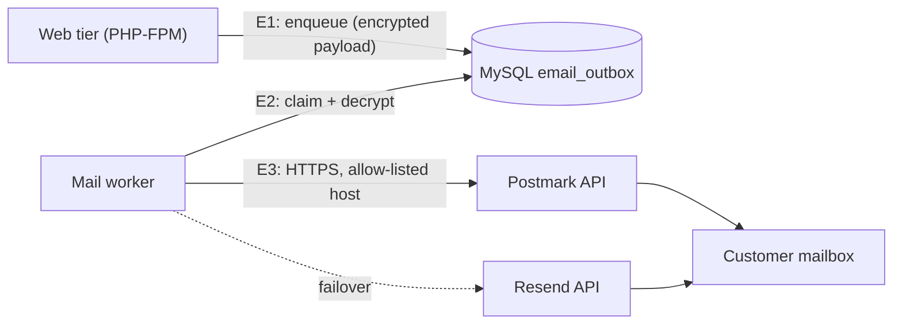

# Threat Model — Transactional Email

| | |
|---|---|
| Epics | BE (Identity, Sprint 1), LIF-01 notifications (Sprint 8) |
| Method | STRIDE per element of the data-flow diagram |
| Requirements | IAM-001, IAM-002, IAM-011, IAM-012, IAM-015, IAM-016, NFR-014 |
| Standard | OWASP ASVS 5.0 Level 2; **Level 3** for the provider API tokens |
| Status | Baseline, written **before** the email code. Closes Identity threat model open item O-4. |
| Decision | CEO, 2026-10-14: **Postmark is primary, Resend is secondary**, switchable at any time. |

Email carries the one-time links for verification, password reset and email
change. It is the customer's recovery root (Identity threat model §4), so a
leak, a forged message or a link pointing at the wrong host is an account
takeover.

## 1. Data flow and trust boundaries

- **E1:** the web tier never talks to an email provider and never holds provider tokens.
- **E2:** only the worker holds the provider tokens and the KEK that decrypts outbox payloads.
- **E3:** outbound HTTPS goes through `ProviderHttpClient`, with allow-listed hosts, TLS verification and timeouts.

## 2. Design decisions

| ID | Decision |
|---|---|
| E-1 | **One port, two adapters.** `TransactionalEmailSender` is implemented by `PostmarkEmailSender` and `ResendEmailSender`. `EMAIL_PROVIDER=postmark\|resend` picks the primary. The other provider is the failover, used only on a timeout, a 5xx response or a 429 after the primary's bounded retries. Never on a 4xx, which is a request we must fix, not retry elsewhere. |
| E-2 | **Transactional outbox.** The web request writes one `email_outbox` row in the same database transaction as the action that needs the email (e.g. creating the account). The worker sends it. A crash between "account created" and "email sent" therefore never loses or duplicates the intent. |
| E-3 | **Encrypted payload, purged after send.** Outbox payloads contain raw one-time tokens. They are encrypted with `SecretCipher` (XChaCha20-Poly1305, AAD = row id + template) and the ciphertext is deleted once the message is accepted or dead-lettered. This keeps Identity D-2 true: at rest, the database holds token hashes only. |
| E-4 | **Bounded retries.** At most 5 attempts with exponential backoff and jitter (1 min to 30 min), then dead-letter and an operator alert. There are no unbounded retries (PCF invariant). |
| E-5 | **Idempotency.** Each send carries the outbox row id as the provider's idempotency key (Resend `Idempotency-Key`; Postmark `Metadata` plus our claim lock). The worker claims rows with `SELECT … FOR UPDATE SKIP LOCKED`. |
| E-6 | **Credentials.** `POSTMARK_SERVER_TOKEN` (one Postmark *Server* per environment) and `RESEND_API_KEY` (sending-only, restricted to our domain) are GitHub **environment secrets**. The deploy agent receives them over the Access-gated tunnel on stdin, writes them to `/etc/paxoficloud/worker.env` (mode 0600), and passes them to the worker container only. They are never put in images, the web tier, logs or the repository. Rotation is a secret update followed by a deploy. |
| E-7 | **Egress.** `ProviderHttpClient` allow-lists exactly `api.postmarkapp.com` and `api.resend.com`, with its existing DNS pinning, non-public-IP deny, TLS 1.2+ and size caps. |
| E-8 | **Links and content.** Links are built only from the configured `APP_URL`. The request `Host` header is never trusted (Identity T-26). Templates live in the repository as plain text plus minimal HTML. Every variable is HTML-escaped, and no customer-supplied HTML is ever rendered. |
| E-9 | **Staging cannot email strangers.** Outside production, the worker delivers only to addresses in `EMAIL_RECIPIENT_ALLOWLIST`. It drops (and logs) every other address, so test data can never reach real people. |
| E-10 | **Logging.** Logs record only the outbox id, template name, provider, provider message id, outcome and a SHA-256 of the recipient. They never contain tokens, links, bodies or plain addresses. |
| E-11 | **Domain authentication.** Mail is sent from `no-reply@paxofi.com`. Postmark and Resend each publish DKIM for the domain, and use a custom Return-Path or bounce subdomain so SPF alignment does not touch the root SPF record that the existing mailboxes depend on. DMARC starts at `p=none` with reports and moves to `quarantine` once both providers align. |
| E-12 | **Bounces and complaints.** Until the bounce webhooks are built (Sprint 8, with HMAC and replay window per the webhook baseline), both providers' own suppression lists stop delivery to hard-bounced or complaining addresses. |

## 3. Threats (STRIDE)

| ID | Threat | Element | Mitigation | Test |
|---|---|---|---|---|
| M-01 | **I:** raw verification or reset tokens readable in a database dump | Outbox | E-3 encrypt and purge | `EmailOutboxEncryptionTest` (stored bytes contain no token; tampered AAD fails) |
| M-02 | **I:** a provider token leaks from the web tier or the logs | Web, logs | E-6, E-10 | `WebTierHasNoEmailCredentialsTest` (container env); log redaction test |
| M-03 | **S:** a forged email from our domain is used for phishing | DNS | E-11 DKIM, SPF alignment, DMARC | Manual DNS check at go-live; DMARC reports reviewed monthly |
| M-04 | **T:** a reset link points at an attacker host (Host-header injection) | Templates | E-8 | `ResetLinkBaseUrlTest` |
| M-05 | **T:** HTML or script injected through a customer's name into the email | Templates | E-8 escaping | `EmailTemplateEscapingTest` |
| M-06 | **D:** a bot sign-up storm burns the provider quota or reputation | Outbox, worker | Identity T-02 rate limits, plus a global per-hour send cap in the worker | `EmailGlobalCapTest` |
| M-07 | **D:** primary provider outage blocks sign-ups and resets | E3 | E-1 failover, E-4 retries | `EmailFailoverTest` (5xx→secondary; 4xx→no failover) |
| M-08 | **R:** cannot prove an email was sent, or why it was not | Worker | E-10 records outcome and provider id per row; dead letters retained 30 days | `EmailOutcomeRecordedTest` |
| M-09 | **I:** staging emails reach real people | Worker | E-9 allow-list | `NonProductionRecipientAllowlistTest` |
| M-10 | **E:** SSRF through the email HTTP client | E3 | E-7 allow-list and the existing `ProviderHttpClient` controls | Existing `ProviderHttpClient` tests plus host allow-list test |
| M-11 | **I:** duplicate sends confuse users or reveal retries | Worker | E-5 claim lock and idempotency key | `EmailIdempotencyTest` |

## 4. Residual risks

- **Duplicate on failover.** If Postmark accepts a message but the response is lost, the Resend failover may deliver it again. The customer can receive two identical emails. That is acceptable, because the tokens stay single-use.
- **Provider sees content.** Both providers process the email body, which includes one-time links. This is mitigated by short token lifetimes (24 h verification, 30 min reset) and single use. It is recorded as a processor in the NDPA data map.

## 5. Open items (CEO)

| ID | Item |
|---|---|
| EM-1 | **Postmark:** create a Server "PaxofiCloud Staging", add the `paxofi.com` sender domain (DKIM plus Return-Path DNS records in Cloudflare), and request account approval. New accounts can only send to their own domain until approved. Store the Server API token as staging secret `POSTMARK_SERVER_TOKEN`. |
| EM-2 | **Resend:** add domain `paxofi.com` (DNS records via Resend's Cloudflare auto-setup), create an API key with *Sending access* restricted to that domain, and store it as staging secret `RESEND_API_KEY`. |
| EM-3 | Confirm the sender address `no-reply@paxofi.com` and the display name "PaxofiCloud". |

## 6. Review log

| Date | Change |
|---|---|
| 2026-10-14 | Baseline written before any email code. Postmark primary and Resend secondary (CEO decision). |
